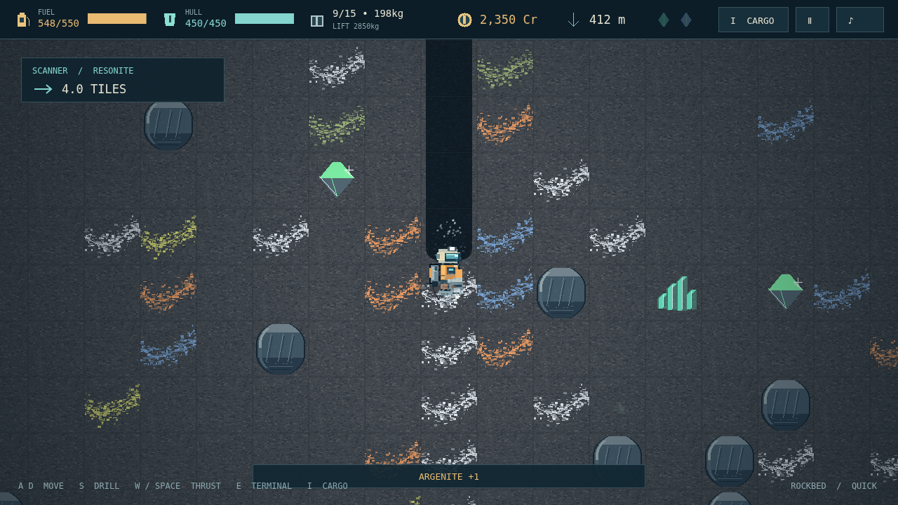

# Deepcore

**Depth is cheap. Height is expensive.** You are the last prospector on a dead mining world, with a worn pressure suit, a handheld drill, and a rocket that exists only as a checklist. The minerals beneath your boots are your only ticket home.

Cut a shaft through the topsoil, follow a silver seam sideways, and decide how much more you dare carry. Every mineral fills a cargo slot, but the weight is what your jetpack has to lift. The fall is free. The climb is not. Bring your haul back to the surface, sell it, buy fuel and repairs, and put the remainder toward stronger equipment or another piece of your escape rocket.

Farther down, cold rock gives way to dark stone and the red glow of the coreshell. A faint wisp may be the only warning before a gas pocket erupts. Lava pools force detours, hard landings punish a heavy bay, and a scanner's tightening bearing promises a rare crystal somewhere beyond the next wall. Resonite and Cryenite belong in your rocket, not on the market.

At the bottom waits the Core. Extract its Sample and the quiet calculation becomes a race: ninety seconds to fly it home and install the final component before it detonates. Choose a short descent or a marathon world, save at the surface pad, or play Hardcore and put the entire expedition on the line. Five components. One launch. No rescue inbound.

